---

## About Me

- BSc CSIT student from Nepal, building practical web and desktop applications.
- Currently exploring backend development with Node.js and PostgreSQL.
- Learning Godot and GDScript to get started with game development.
- Interested in full-stack development, desktop applications, and game development.
- Future goals: Mobile app development with React Native and game development with Godot/C++.

---

---

## Skills

---

## Latest Projects

---

## Connect

